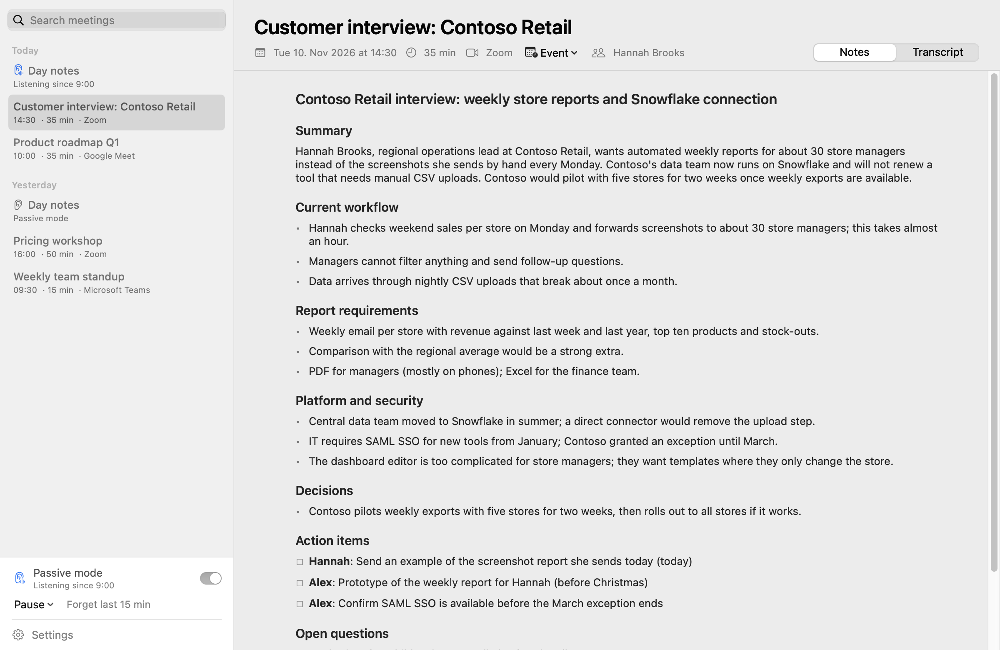
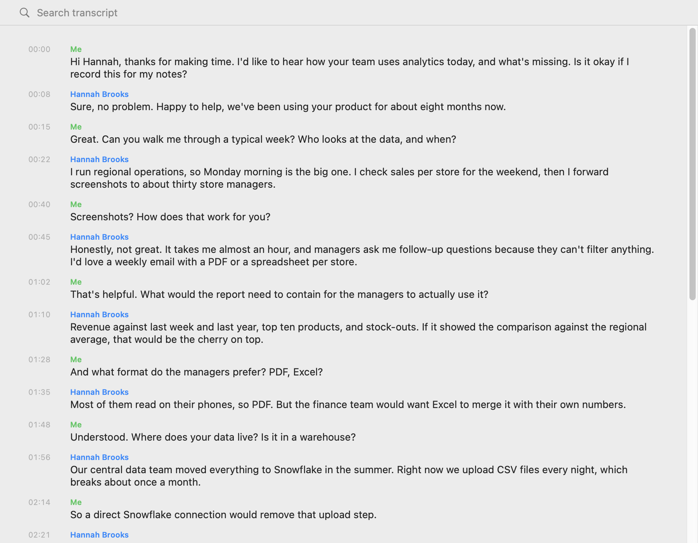
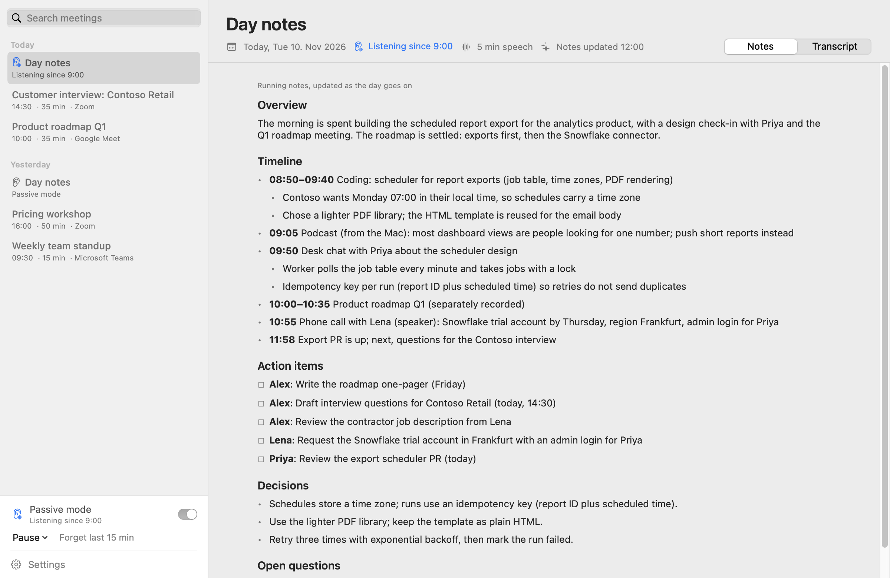
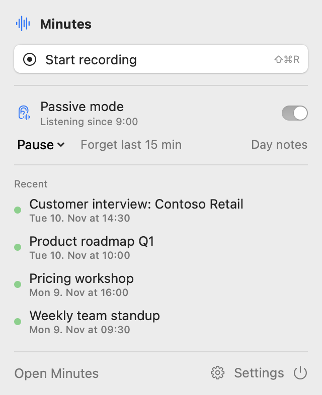

# Minutes

A free, open-source meeting notetaker for Apple Silicon Macs, an alternative to cloud tools such as Granola.
No bot joins your call: Minutes notices when a call app starts using the microphone, offers to transcribe, shows
a live transcript, and afterwards writes structured notes.



- **Local transcription.** Speech is transcribed on your Mac's Neural Engine, live during the call; audio never
  leaves the Mac and is deleted after transcription unless you keep it.
- **Notes with your own API key.** Claude Haiku 5.5 turns the transcript into a summary, decisions, action items and
  open questions, for about one cent per meeting hour. Only text is sent. Without a key you still get transcripts.
- **Data Protection mode.** One switch, and only your own microphone is transcribed: what the other participants say
  through your Mac is never captured, not even briefly. The notes are written from your side of the conversation and
  mark what they infer about the other side. Set the default in Settings, override it per meeting or day with the
  shield in the toolbar ([details](#data-protection-mode)).
- **Passive mode (optional).** Listens all day and keeps running notes of what was discussed and what you promised,
  text only, at about 0.15–0.35 % of a MacBook battery per hour (measured: [Passive mode](#passive-mode)).
- **Notes as files, synced to git, encrypted.** Every meeting and day is plain Markdown and JSON in a folder you
  choose. Optionally Minutes pushes meeting notes and day notes to a git repository encrypted with git-crypt, so
  coding agents and scripts can read your history from a clone with the key, while the host only sees ciphertext.
- **Calendar-aware.** Titles and attendees come from the event running now; names are corrected with your vocabulary.
- **No account, no server, no bot in the call.** Works with Zoom, Teams, Meet in any browser, Slack, FaceTime, Webex
  and in-person meetings.

| Transcript with named speakers | Passive mode: notes of the day | Menu bar |
|---|---|---|
|  |  |  |

## Install

Requires macOS 15 or later on a Mac with Apple Silicon (M1 or newer).

1. Download `Minutes-<version>.dmg` from [Releases](../../releases), open it and drag **Minutes** to Applications.
2. Open Minutes. macOS says "Apple could not verify Minutes", because releases are not notarized (that needs a paid
   Apple developer account). Click **Done**.
3. Open **System Settings → Privacy & Security**, scroll down to "Minutes was blocked" and click **Open Anyway**, then
   confirm with your password. The button shows for about an hour after the blocked launch.
   Or, in Terminal, once: `xattr -dr com.apple.quarantine /Applications/Minutes.app`
4. Allow **Microphone**, **System Audio Recording** and **Calendar** access when asked.

After an update macOS asks for these permissions again, because each release has a new ad-hoc signature, and asks
once whether Minutes may read its API key from the keychain (click Always Allow). Settings shows the installed
version at the bottom of every tab, with a link to new versions.

**Updating** (also to switch from a self-built copy): quit Minutes (power button in the menu bar window), delete the
old app (`/Applications/Minutes.app`, or `~/Applications/Minutes.app` for a copy built with `scripts/build-app.sh`), and
install the new DMG as above. Meetings, day notes and settings are kept: they live in your library folder and in
`~/Library/Application Support/Minutes/`, not in the app.

**Build from source** (needs the Xcode Command Line Tools: `xcode-select --install`; full Xcode is not needed):

```bash
scripts/build-app.sh --open      # builds, signs ad hoc, installs to ~/Applications/Minutes.app and opens it
scripts/create-signing-cert.sh   # optional, once: a stable local signature, so permissions survive rebuilds
```

## Setup

On first launch macOS asks for **Microphone**, **System Audio Recording** and **Calendar** access, and the speech
models (about 0.7 GB) download in the background to `~/Library/Application Support/FluidAudio/Models`.
Everything else is optional:

- **Notes:** create a key at [console.anthropic.com](https://console.anthropic.com) → API keys and paste it in
  Settings → Notes. It is stored encrypted in the macOS keychain. Notes cost about one cent per meeting hour.
  Without a key, meetings get a transcript and a date-and-time title.
- **Background:** Settings → Background takes your name, your role, abbreviations, people and projects, and a
  vocabulary list. The transcript is corrected with the vocabulary, and Claude uses all of it to fix misheard names.
- **Calendar:** titles and attendees come from the macOS Calendar database, so any account added under System
  Settings → Internet Accounts works (Google, iCloud, Exchange). For a Google calendar shared into your account,
  tick it at [calendar.google.com/calendar/syncselect](https://calendar.google.com/calendar/syncselect). Without
  calendar access, meetings are named by the app and the notes.
- **Sync:** see [Sync to a git repository](#sync-to-a-git-repository).

## Using it

- Join a call in Zoom, Teams, Meet (any browser), Slack, FaceTime, Webex, … and click **Start transcribing** in the
  notification or the menu bar. Or press ⇧⌘R any time, also for in-person meetings. With Settings → General →
  "Record detected calls without asking", recording starts as soon as a call app takes the microphone.
- A recording takes its title and attendees from the calendar event running now, and the menu bar says which one
  ("Links to …") with a "Record without it" button next to it. When no event is running there is nothing to choose.
  To record for another of today's events, click it in the menu bar's list or under the arrow next to Record in the
  main window. Afterwards, the calendar button in a meeting's header links it to a different event.
- The main window and the menu bar offer the same things: record, passive mode, Settings (also ⌘,).
- While recording, type your own notes next to the live transcript. The generated notes cover every point in them.
- Recording stops 20 s after the call app releases the microphone, or with ⇧⌘R. If the same app takes the microphone
  again within 15 minutes (a dropped call), Minutes offers to **Continue** the meeting. Any meeting can also be
  continued, or merged with the one before it, from its ⋯ menu; speakers are matched across the parts by voice.
- Select any part of the notes or the transcript (with times and speakers) and copy it, or copy everything with
  the toolbar's copy button: the notes as Markdown on the Notes tab, the transcript on the Transcript tab. Click a
  speaker label to name that speaker, then regenerate the notes.
- Delete a meeting with the trash button, the Delete key or the context menu.
- Automation: `open minutes://start`, `minutes://stop`, `minutes://toggle`, `minutes://open`, and for passive mode
  `minutes://pause` (`?minutes=N`, default 15) and `minutes://resume`.

**Consent:** many jurisdictions require everyone's consent before a conversation is recorded or transcribed (in
Germany, recording private speech without consent is a criminal offence). Tell the other participants, or use
Data Protection mode.

## Data Protection mode

For calls where you cannot ask everyone for consent, or simply do not want to record other people: with Data
Protection on, Minutes transcribes only your microphone and never starts the system-audio capture, so what the other
participants say through your Mac is not recorded, buffered or transcribed at any point. Your notes still work: the
notes model is told it has one side of the conversation, infers what the others asked or proposed from your replies
where that is clear, marks such points as inferred, and lists what others committed to only when you repeated or
confirmed it.

- **Default and override.** Settings → General → Data Protection sets the default for new meetings and passive days.
  The shield button in the toolbar of a meeting (while it records) and of today's day notes switches it for that
  meeting or day; the menu bar shows "Mic only" instead of the "Them" level meter.
- **Switching during a meeting.** On: system audio stops at once, and what was captured of the others before is
  dropped from the live transcript and deleted unheard when the meeting is processed. Off: the others are recorded
  from that moment on. A finished meeting keeps its mode.
- **Switching during a passive day** applies from that moment on. The day transcript shows a line where it changed,
  and the day notes are written with that in mind.
- **Use headphones.** Without the system audio Minutes cannot remove loudspeaker echo, so with speakers the
  microphone would pick up the other side. The meeting header warns while the Mac plays through its speakers.
- **People in the same room** are still heard by the microphone. Data Protection keeps out the remote side, not
  voices next to you.
- Meetings and days recorded this way carry `"dataProtection": true` in `meeting.json` and `data_protection: true` in
  the synced notes.

## Passive mode

Off by default. When switched on (menu bar or Settings → General, after a consent notice), Minutes listens all day
to the microphone and to what the Mac plays, transcribes it on the Neural Engine, and keeps running notes of
the day that Claude updates every 10–30 minutes of new speech: conversations, decisions, tasks (above all what you
promised to do), dates, people. Videos, music, podcasts, TV, small talk and other people's conversations are
filtered out. After midnight (or on demand) a **day summary** is written that also folds in the notes of meetings
recorded that day.

Each day with passive data has a **Day notes** entry in the sidebar, first in its date section above that day's
meetings. It works like a meeting: Notes and Transcript tabs, copy, update notes, delete.

- **Text only.** Audio stays in memory until its utterance (at most 28 s) is transcribed; no audio is written to disk.
- **Meetings win.** While a normal meeting recording runs, passive capture pauses; the day transcript links to the
  meeting and the notes list it by title.
- **Live while you watch.** While today's transcript is on screen, lines appear as they are spoken (every 2 s, grey
  until stored). Otherwise each utterance is transcribed once, when it ends, which keeps the all-day cost low;
  microphone lines are stored 30 s later, after a check that they are not just the loudspeakers' echo.
- **Pauses automatically** while the screen is locked, while the Mac sleeps, and on battery below 20 % (configurable),
  and on demand from the menu bar or the sidebar (15 min, 1 h, until tomorrow). "Forget last 15 min" deletes recent
  text; deleting a day's notes moves its folder to the Trash.
- **Visible.** The menu bar icon is an ear while Minutes listens (macOS also shows its orange microphone dot).
- **Headsets keep their quality.** Passive mode records from the built-in microphone when the default input is a
  Bluetooth headset, because opening a headset's microphone switches it to its low-quality call profile.
- **Cost.** Measured on an M5 Pro, including Core Audio's share: about 2.5 % of one CPU core in silence and 5.5 %
  while speech plays, ~1 % Neural Engine time, ~80 MB memory that stays flat. Estimated 0.1–0.25 W, i.e. 1–2.5 Wh
  over a 10-hour day (2–3.5 % of a 72 Wh battery). API cost: a few cents per day.
- **Consent.** It transcribes people who may not know it. Tell the people around you and pause when someone objects.

One folder per day, next to the meetings:

```
Days/2026-11-09/
  transcript.jsonl   append-only, one line per utterance (time, Mic/Mac, text), flushed as each utterance ends
  transcript.md      the same, readable
  digest.md          running notes (replaced on each update)
  summary.md         end-of-day summary
  day.json           digest progress, API cost, and the day's Data Protection choice
```

## How it works

| Step | What happens | Where |
|---|---|---|
| Detection | Every 1.5 s, Core Audio's process list shows which apps capture from an input device; call apps and browsers count as meetings. After 3 s a notification offers to transcribe. | local |
| Capture | Two streams: the microphone ("Me", through a Core Audio IOProc) and everything the Mac plays ("Them", through a Core Audio process tap; no virtual audio driver). Both are aligned on the host clock and written as 16 kHz audio while the meeting runs. With Data Protection the tap does not run. | local |
| Live transcript | Silero VAD cuts each stream into utterances; Parakeet transcribes each one as it ends, and every ~1.5 s while it is still going. | local, Neural Engine |
| Final transcript | After the meeting both channels are transcribed again in full. The "Them" channel is split into speakers (pyannote community-1 + VBx), the microphone too when several people share the room (the one who talks most is "Me"). Loudspeaker echo is dropped from the microphone channel and the vocabulary is applied. A one-hour meeting takes well under a minute. Then the audio is deleted. | local, Neural Engine |
| Notes | Transcript, your own notes, calendar attendees, vocabulary and background go to Claude Haiku 5.5, which writes a summary, topics, decisions, action items and open questions. | Anthropic API |
| Sync (optional) | Notes and transcripts are committed to a git repository, encrypted with git-crypt, and pushed. | your git remote |

### Speech model

Speech models run through [FluidAudio](https://github.com/FluidInference/FluidAudio). Parakeet Ultra is the default
after measuring word error rates on FLEURS German and English (80 clips each; plain normalization, so read the
numbers relative to each other). All three handle German and English in the same meeting without configuration.

| Model | German WER | English WER | Speed (× real time, M5 Pro) |
|---|---|---|---|
| Parakeet Ultra (default) | 4.4 % | 5.1 % | ~190 |
| Parakeet TDT v3 | 5.8 % | 5.5 % | ~190 |
| Nemotron Unified 0.6B | 5.6 % | 4.6 % | ~155 |

### Notes model

Notes always use Claude Haiku 5.5 at high reasoning effort (`AppSettings.summaryModel` and `summaryEffort`); there
is no model setting. In a blind comparison on a real 50-minute call against Sonnet 5.5 (low, medium and high effort)
and Haiku 5.5 at medium effort, it matched Sonnet on names and details at about a tenth of the cost. It takes
30–60 s per meeting. `minutes-cli compare` reruns such a comparison.

## Files

Every meeting is a folder in `~/Documents/Minutes` (configurable), readable by any tool:

```
2026-11-09 14-30 Weekly sync/
  meeting.json      metadata (title, times, app, attendees, speaker names, recording parts, status)
  summary.md        generated notes
  notes.md          your own notes
  transcript.md     readable transcript; transcript.json has word timings
  speakers.json     voice embedding per diarized speaker (matches speakers across recording parts)
  audio-me.m4a      only if "Keep audio recordings" is on (AAC, ~15 MB per hour); also audio-them.m4a,
                    and audio-me-2.m4a, … for continued meetings
```

Settings live in `~/Library/Application Support/Minutes/`: `settings.json`, `context.md` (background),
`vocabulary.txt` (one term per line, misrecognitions after a colon: `Acme: akme, ack me`), an optional
`summary-prompt.md` that replaces the built-in notes instructions, and `logs/app.log`.

## Sync to a git repository

Settings → Sync takes a git remote, for example a new private GitHub repository. After each meeting, and when notes,
titles or speaker names change, Minutes commits and pushes. Passive mode's day notes go once a day, when the day
summary is written after midnight (or at the next launch if the Mac was off), so the history does not fill with
small updates. "Update notes" and "Write day summary now" push a day right away, and "Forget last 15 min" removes the
text from a day that is already there. At launch Minutes exports all meetings and finished days once more, which
catches up on anything that could not be pushed before (unchanged files make no commit). Deleting a meeting or a
day removes it from the repository (it stays in the git history).

```
README.md, .gitattributes             plain text
index.md                              all meetings, newest first, then all days
meetings/2026/2026-11-09-1430-weekly-sync-b2a314b9/
  notes.md                            YAML front matter (title, start/end, attendees, event, speakers) + notes
  transcript.md
  my-notes.md                         your own notes, if any
days/2026/2026-11-09/
  notes.md                            the day summary, or the running notes while the day lasts
  transcript.md                       the day's transcript in time order (Mic / Mac)
```

File contents are encrypted with [git-crypt](https://github.com/AGWA/git-crypt); folder names and commit messages
stay readable (date, time, title) so files are easy to find. Before each push Minutes checks that every meeting
and day file is encrypted and refuses to push otherwise. Audio is never synced. Repositories created by earlier
versions get the `days/` encryption rule added to `.gitattributes` automatically on the next sync.

Setup: `brew install git-crypt`, make sure `git push` to the remote works from your account (for GitHub:
`gh auth setup-git`), then enter the remote URL. On the first sync to an empty repository Minutes runs
`git-crypt init` and saves the key to `~/Library/Application Support/Minutes/notes-repo.git-crypt.key`. Back the
key up in a password manager; another machine or a cloud agent unlocks a clone with `git-crypt unlock <keyfile>`.

## Development

```bash
swift build -c release                      # app + CLI
.build/release/minutes-cli transcribe --model parakeet-ultra file.wav
.build/release/minutes-cli process --me me.wav --them them.wav --library /tmp/lib [--no-summary] [--data-protection]
.build/release/minutes-cli record --seconds 30 --live
.build/release/minutes-cli summarize --library /tmp/lib --meeting "<folder>"
.build/release/minutes-cli merge --library <dir> --meeting "<first>" --with "<second>" --summarize
.build/release/minutes-cli compare --library <dir> --meeting "<folder>" --models claude-haiku-5-5:high,claude-sonnet-5-5:low --out ab.json
.build/release/minutes-cli sync-notes       # export all finished meetings and days to the configured repository
.build/release/minutes-cli delete --meeting "<folder>"
build.noindex/Minutes.app/Contents/MacOS/Minutes --snapshot /tmp/snap   # render the UI to PNGs
open -n -a ~/Applications/Minutes.app --args --calendar-report /tmp/cal.txt 2   # calendars and events the app sees
.build/release/minutes-cli passive --seconds 120 --library /tmp/lib --digest   # passive capture + CPU/ANE stats
.build/release/minutes-cli passive --seconds 75 --library /tmp/lib --me-file me.wav --them-file them.wav --preview   # the same from files, nothing audible
.build/release/minutes-cli digest --library /tmp/lib --day 2026-11-09 [--reset] [--final]   # digest / day summary
```

- The CLI reads `ANTHROPIC_API_KEY` from the environment or `./.env` (gitignored); it never reads the app's keychain.
- `MINUTES_SUPPORT_DIR=/some/dir` isolates settings, vocabulary and logs for tests. The app then skips the keychain
  too (the key comes only from `ANTHROPIC_API_KEY`), as it does with `--snapshot`.
- `bench/make_meeting.py OUTDIR` synthesizes a German/English test meeting with macOS voices (separate tracks).
- `bench/wer.py` scores `minutes-cli transcribe --jsonl` output against references. FLEURS clips:
  `https://huggingface.co/datasets/FluidInference/fleurs/resolve/main/<lang>/<file>` (de_de, en_us; files
  `<lang>_0000.wav`… and `<lang>.trans.txt`) into `bench/data/fleurs/<lang>/`, then
  `minutes-cli transcribe --model <m> --jsonl bench/out/<m>.<lang>.jsonl bench/data/fleurs/<lang>/*.wav` and
  `bench/wer.py bench/out/*.jsonl`.

## Releases

GitHub Actions builds the DMG on every push to `main` ([workflow](.github/workflows/release.yml), Apple Silicon
runner, ad-hoc signature). To publish a release, raise `CFBundleShortVersionString` in `Resources/Info.plist` and push:
when no release `v<version>` exists yet, the workflow creates it with the DMG and install notes attached. Other pushes
keep the DMG as a workflow artifact for 30 days.

To build a release on your own Mac instead (Command Line Tools are enough):

```bash
scripts/make-release.sh 0.1.0                # dist/Minutes-0.1.0.dmg, signed ad hoc
gh release create v0.1.0 dist/Minutes-0.1.0.dmg --title "Minutes 0.1.0" --notes "…"
```

With an Apple Developer ID, set `MINUTES_SIGN_IDENTITY` and `NOTARY_PROFILE` (see `scripts/make-release.sh`) to get a
notarized DMG that opens without the Privacy & Security step.

## License

MIT (see [LICENSE](LICENSE)). Speech models are downloaded from Hugging Face under their own licenses (CC-BY-4.0,
MIT, OpenMDW); see [THIRD_PARTY_NOTICES.md](THIRD_PARTY_NOTICES.md). Not affiliated with Granola or Anthropic.
